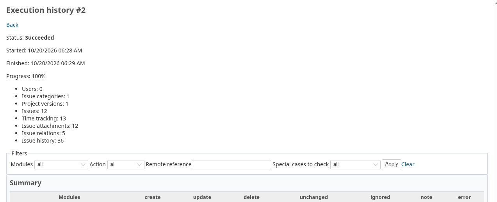

<!--
File: redmine_mirror/README.md

Redmine Mirror - modular project import and asynchronous replication.
SPDX-License-Identifier: GPL-2.0-or-later

This program is free software: you can redistribute it and/or modify it
under the terms of the GNU General Public License as published by the
Free Software Foundation, either version 2 of the License, or (at your
option) any later version.

This program is distributed in the hope that it will be useful,
but WITHOUT ANY WARRANTY; without even the implied warranty of
MERCHANTABILITY or FITNESS FOR A PARTICULAR PURPOSE. See LICENSE for details.

Document Mirror setup, operation, extension points or validation evidence.
-->

#  Redmine Mirror




One-way, module-by-module replication of a Redmine project into another Redmine.
Mirror reads the source through its REST API and imports the selected modules into an
existing destination project, through the destination REST API and native models.

Use it to migrate projects to a new instance, or to keep a regularly updated secondary
copy. Each project has its own connection, mappings, schedule, history and conflicts.
Version **1.0.0-beta.8** is a pre-release for testing before 1.0.0, not a stable release.

## Features

| Module | Imported data |
| --- | --- |
| Issues | Subject, description, tracker, status, priority, assignee, privacy, author, dates |
| Time tracking | Hours, activity, date, comments, user, issue |
| Issue categories, project versions | Categories with assignee; versions with status, due date and sharing |
| Issue history | Notes, private notes, supported field changes, authors, dates |
| Issue attachments | Current files (32 MiB max.), descriptions, authors, dates |
| Issue relations | Type and delay, including endpoints in other mirrored projects |
| Issue hierarchy | Parents, including parents imported by another project |
| Issue watchers | Mapped active users who can see the issue |
| Issue custom fields | Existing compatible local fields, list value mappings, history |
| Users | Identity mappings and anonymization; no account is created |

- Preview before writing, manual runs and automatic schedules.
- Logs with remote and local IDs, links, filters and progress.
- Local changes detected as conflicts, never overwritten.
- Pending cross-project relations and parents listed for follow-up.
- Source API keys encrypted, never displayed or logged.
- Text formats converted to the destination's: Textile or Markdown to HTML for CKEditor,
  detected per text.
- Execution log with a summary, errors grouped by cause and the special cases to check
  (converted texts, links, images, attachments).
- A failing object is skipped and the rest synchronized, or the run stops: your choice.

## Requirements

- Destination: Redmine with this plugin, the REST API enabled, a `database_cipher_key`,
  and a worker sharing its database, attachment storage and cipher key.
- Source: any Redmine with the REST API enabled; Mirror is not needed there. Use the key
  of a dedicated, read-only account member of the source projects
  (see [source permissions](doc/CONFIGURATION.md#2-enable-the-rest-api)).
- HTTPS URLs on both sides.
- With SQLite, keep the `timeout: 5000` of Redmine's sample `database.yml`: the worker and
  the web process write to the same database.
- Existing destination projects, users, trackers, statuses, priorities, activities and
  custom field definitions: Mirror maps them, it never creates them.

Validated with SQLite: destinations **Redmine 6.1.4 and 5.1.13**, sources **Redmine 4.2,
5.0 and 6.1**. Other versions and databases are not validated yet. See the
[compatibility matrix](test/compatibility/README.md) and the
[validation record](test/environment/VALIDATION.md).

## Installation

Source code and issue tracker: [likehopper/redmine_mirror](https://github.com/likehopper/redmine_mirror).

Place this directory at `plugins/redmine_mirror`, set `database_cipher_key` in
`config/configuration.yml`, then from the Redmine root:

```sh
RAILS_ENV=production bundle exec rake redmine:plugins:migrate NAME=redmine_mirror
```

Restart Redmine and schedule the worker, for example every minute with cron or a
systemd timer, with `MIRROR_DESTINATION_URL` and `MIRROR_DESTINATION_API_KEY` provided
by its environment or a secret manager:

```sh
RAILS_ENV=production bundle exec rake redmine_mirror:tick
```

Without the worker, runs stay queued. Then follow the illustrated
[configuration guide](doc/CONFIGURATION.md):

1. Enable the REST API.
2. Grant *View Mirror* and *Configure Mirror mappings* to the relevant roles.
3. Enable the **Mirror** module on the destination project.
4. As an administrator, set the source connection and modules.
5. Map users and references.
6. Run a preview, then synchronize.

### Upgrading

Back up the database, attachment storage and plugin directory. Stop web and worker
processes, replace the plugin, run the migration above, restart both, then check the
mappings and run a preview. To revert a schema change, restore the database, files and
plugin together.

### Uninstalling

Back up first and stop web and worker processes. While the plugin is still installed:

```sh
RAILS_ENV=production bundle exec rake redmine:plugins:migrate NAME=redmine_mirror VERSION=0
```

Remove `plugins/redmine_mirror` and restart Redmine. Mirror's configuration,
correspondences and logs are deleted; imported issues and other native objects remain.
Without correspondences, a new import would duplicate them.

## Documentation

- [Configuration guide](doc/CONFIGURATION.md): from activation to the first
  synchronization, step by step with screenshots.
- [Module reference](doc/MODULES.md): each module's behavior, anonymization, conflicts,
  scheduling, command-line runs and limits.
- [Adapter tutorial](doc/ADAPTERS.md): write a module, in Mirror or in another plugin.
- [Developer guide](doc/DEVELOPMENT.md): architecture and conventions.

## Scope and limitations

Mirror keeps a secondary copy of the selected modules the source API key can read.
**It is not a backup**: keep normal database and file backups. It does not copy instance
configuration, accounts, roles or hidden data, and does not propagate deletions.

- Wiki, project files and SLA modules are not implemented yet. Reporting settings and
  credit policies come with redmine_reporting when it is installed on the destination.
- Some historical change types are not supported and fail explicitly.
- Destination workflows and validations apply: a preview cannot guarantee every write.
- Runs are not atomic across API calls; there is no automatic retry, merge or forced
  overwrite. After a crash, inspect the destination before rerunning.

Details in the [module reference](doc/MODULES.md#limits).

## Tests

Standalone tests, from the plugin directory:

```sh
ruby test/core_test.rb
ruby test/client_test.rb
ruby test/adapter_example_test.rb
```

- [CI runner](test/compatibility/README.md): full Redmine suite in a disposable container.
- [Two-instance environment](test/environment/README.md): seeded source and destination,
  worker and real API smoke checks.
- `bash test/documentation/run.sh`: regenerates the configuration guide's screenshots.

## Community and releases

Read the [contribution guide](CONTRIBUTING.md) and [code of conduct](CODE_OF_CONDUCT.md).
Report vulnerabilities privately as described in [SECURITY.md](SECURITY.md).
See the [changelog](CHANGELOG.md) and the [release procedure](RELEASING.md).

## License

GPL-2.0-or-later; see [LICENSE](LICENSE). Third-party artwork keeps its own license.

## Credits

Icons created by [Magnific](https://www.flaticon.com/fr/auteurs/magnific)
on [Flaticon](https://www.flaticon.com/). See the [image credits](assets/images/CREDITS.md).
