<!--
File: redmine_mirror/doc/CONFIGURATION.md

Redmine Mirror - modular project import and asynchronous replication.
SPDX-License-Identifier: GPL-2.0-or-later

This program is free software: you can redistribute it and/or modify it
under the terms of the GNU General Public License as published by the
Free Software Foundation, either version 2 of the License, or (at your
option) any later version.

This program is distributed in the hope that it will be useful,
but WITHOUT ANY WARRANTY; without even the implied warranty of
MERCHANTABILITY or FITNESS FOR A PARTICULAR PURPOSE. See LICENSE for details.

Document Mirror setup, operation, extension points or validation evidence.
-->

# Configuration guide

From an installed plugin to a first synchronization, in twelve steps. Everything
happens on the **destination** Redmine; the source only needs its REST API and an API
key. Module details are in the [module reference](MODULES.md).

Mirror has two places in a project:

- **Settings → Mirror**: the configuration (connection, automatic synchronization, one
  mapping tab per module), for members allowed to configure Mirror;
- the **Mirror** menu: the operations (getting started, launching, execution history,
  conflicts, pending links, imported objects).

The screenshots come from the browser test
[`configuration_test.rb`](../test/documentation/configuration_test.rb). It mirrors the
*mirror-demo* project of a seeded source (12 issues with notes, attachments, a category,
a version and relations to other projects) into an empty *Mirror Demo* project. That
disposable setup uses HTTP; real installations require HTTPS.

## 1. Check the installation

`Administration → Plugins` lists **Redmine Mirror**. If not, see
[Installation](../README.md#installation).

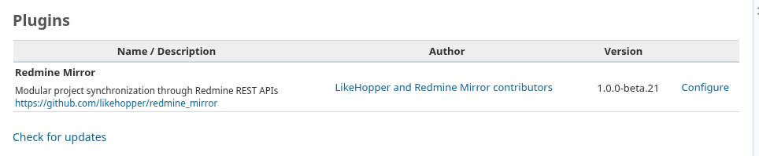

## 2. Enable the REST API

`Administration → Settings → API`: tick **Enable REST web service**, on both the source
and the destination. The worker writes issues and time entries through the destination
API.

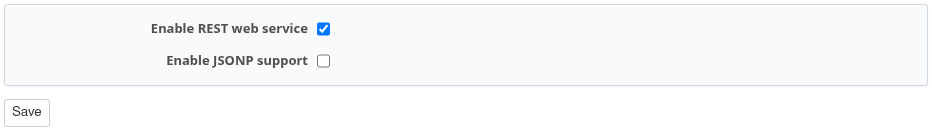

The source API key determines what can be imported: data it cannot see is skipped.
Use the key of a dedicated, non-administrator source account, member of the source
projects with a read-only role:

| Source permission | Needed for |
| --- | --- |
| View issues, issues visibility **All issues** | Issues, private issues, history, relations, hierarchy, versions |
| View private notes | Private notes |
| View spent time, visibility **All time entries** | Time tracking |
| View watchers list | Watchers |
| View wiki, View wiki history | Wiki |
| View members (public by default) | Members |
| View documents | Documents ([Mirror source](#mirror-source-on-the-source-redmine) on the source) |
| View files | Files |
| View issues | Saved queries ([Mirror source](#mirror-source-on-the-source-redmine) on the source; private queries included) |
| View sprint board (Scrum plugin) | Agile sprints and issue data ([Mirror source](#mirror-source-on-the-source-redmine) on the source, redmine_agile PRO on the destination) |
| View issues | Tags ([Mirror source](#mirror-source-on-the-source-redmine) on the source, Redmine Tags plugin on both sides) |
| View news | News ([Mirror source](#mirror-source-on-the-source-redmine) on the source) |
| Manage issue categories (optional) | Category default assignees; without it, categories come from the issues that use them |

Projects the account is not a member of are not visible. **Issue custom fields** also
work without an administrator key: Redmine then hides the field definitions, so the
fields and their values come from the source issues, each value takes the format of
the destination field you map it to and is checked in the preview, and list choices
are the values found in the issues and their history. An administrator key adds
format compatibility checks and the complete lists of possible values.

## 3. Allow the source Redmine

`Administration → Plugins → Redmine Mirror → Configure`: list the source Redmine URLs,
one per line. Every project then chooses its source from this list, administrators
included; while the list is empty, only administrators can connect, to any URL.
**User company field** picks the user custom field shown as the company
in the user mappings (by default, a field named Company, Société or Entreprise).
Optional AI proposals for long mapping lists are set in **Administration → Mirror → AI**:
see [AI usage](AI.md).

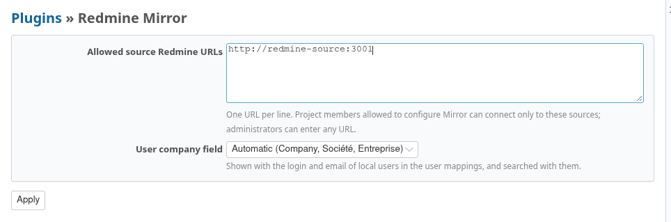

## 4. Grant the permissions

`Administration → Roles and permissions → <role>`, **Mirror** block:

| Permission | Allows |
| --- | --- |
| **View Mirror** | Mirror menu: status, execution history and logs, conflicts, pending links, objects |
| **Run Mirror synchronizations and resolve conflicts** | The above, plus preview, synchronize now, cancel a queued run, keep or recheck a conflict |
| **Configure Mirror** | The above, plus the **Settings → Mirror** tab: connection, schedule and mappings |

Members who can enable the project's modules (*Select project modules*) can also
configure Mirror.

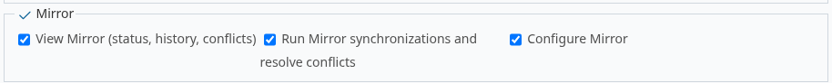

## 5. Enable the module

`Project → Settings → Project`: tick **Mirror** under **Modules**, then save. Keep
*Issue tracking* and *Time tracking* enabled for the modules you import.

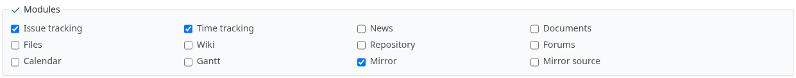

The **Mirror** tab appears in the project menu.


Until a first synchronization, it shows **Getting started**: each step, its state, and
a link to the page of the next one.

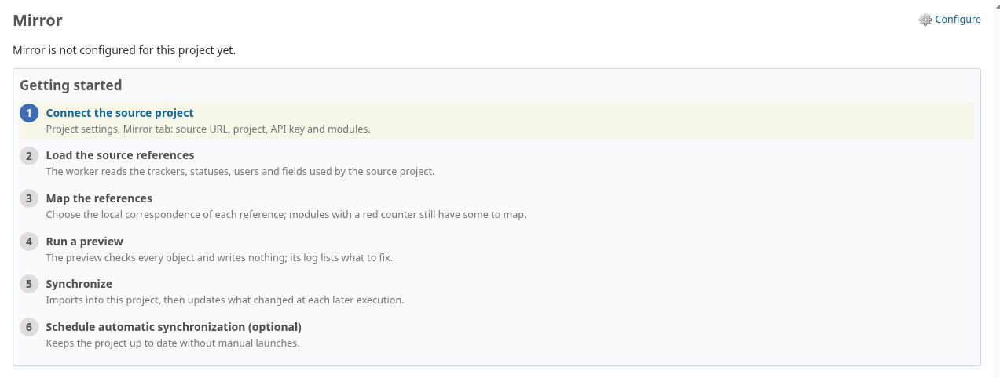

## 6. Connect the source

**Connect the source project** opens **Settings → Mirror → Connection**:

- **Source Redmine URL**: chosen from the allowed sources;
- **Source project**: its identifier, as in `<source>/projects/<identifier>`, or its numeric ID;
- **Source API key**: stored encrypted and never displayed again;
- **Source text format**: *Auto* detects Textile, Markdown or HTML (CKEditor) for each
  text; choose a format to force it. Texts are converted to this Redmine's text format,
  and issue references point to the imported issues; the detected formats are shown
  after saving;
- **Modules** to import. Dependencies are added on save: *Time tracking* adds *Issues*,
  and both add *Users*.

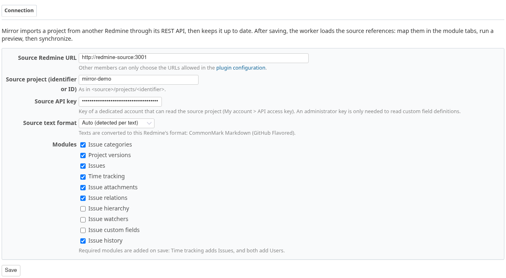

Saving checks the connection; the worker then loads the source references, which can
take a few minutes on large projects. The page shows its progress and refreshes until
it has finished. The URL and project cannot be changed afterwards. **Refresh source
references** reloads them after new users, statuses or activities appear on the source.

A red counter on a module tab gives the number of references it still has to map.

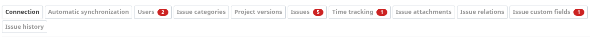

## 7. Map users

**Users** lists the users found in the source data. Map each one to a member of the
project, locked accounts of people who left included, or **Anonymize** them. With the
**Members** module, members managers can choose any account of this Redmine. Each local
account shows its login (to administrators), email (unless hidden, except to
administrators) and company; typing in the list searches all of them. Time
logged by an anonymized user goes to the **local user for anonymized time**: here the
source administrator is anonymized and a dedicated *Mirror Archive* member receives
that time.

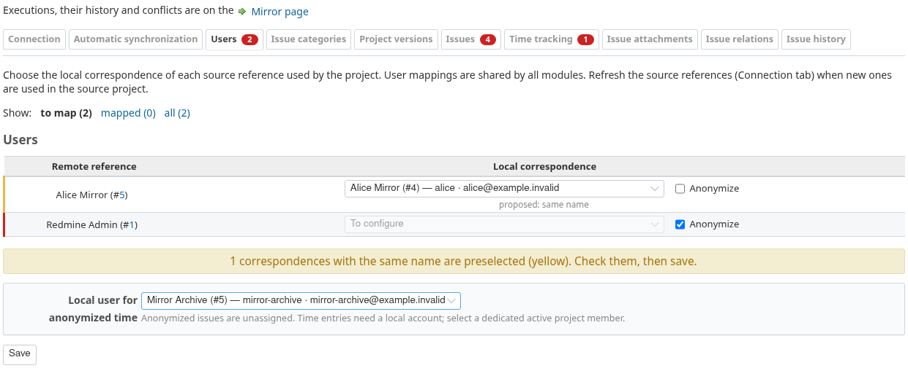

The user table is shared by every module. Mirror creates no account during a run: add
the missing members to the project first, or create their accounts from the source.

### Create accounts from the source

When the source project shares **Users** ([Mirror source](#mirror-source-on-the-source-redmine)),
each source user shows its login, email and company, and a local account with the same
email is preselected before one with the same name. Redmine's users API gives emails to
administrators only; Mirror source lets a project manager use them.

**Accounts to create**, below the table, lists the unmapped source users whose email has
no account here. Check them, optionally check roles to add them as members, and click
**Create the checked accounts**: each gets a registered account (login, name, email and
company of the source, no password), awaiting activation as after a self-registration,
mapped to its source user. Administrators receive Redmine's activation request. A login
already taken, or a required user field, leaves that account out with the reason.

This needs **Create accounts from Mirror sources** in `Administration → Plugins → Redmine
Mirror → Configure` (off by default) and *Manage members* on the project; the roles
offered are those the user may give.

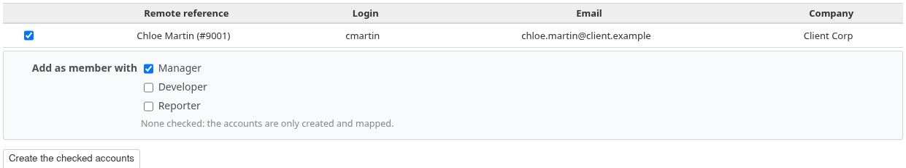

## 8. Map the references

Each module tab lists the source references it needs. **Issues** maps trackers,
statuses and priorities. Only the references used by the source project's issues and
their history are listed, plus those already mapped; a link shows the others. Local
statuses are limited to those of the project's tracker workflows. Long lists, such as
users, can be filtered by typing. **Show** lists the references to map first, then the
mapped ones or all of them.

A checkbox beside the field replaces a local reference: **Anonymize** a user, or leave
a tracker, status, activity or document category out of the import (**Do not import
its issues**, *its time entries*, *its documents*). Custom fields, roles and groups
have their own (*Ignore this field*, *Do not give this role*, *Do not add this group*).
The checked box greys the field.

A reference without correspondence is marked in red. When a single local reference has
the same name (ignoring case, accents, punctuation and word order), it is preselected and
marked in yellow: check it, then save. With [AI proposals](AI.md) enabled, a table with
many references without correspondence offers **Propose with AI**: the proposals are
preselected the same way, marked *proposed by AI* with a confidence. Correspondences
marked *administrator default* come from the
[default correspondences](#default-correspondences-optional).

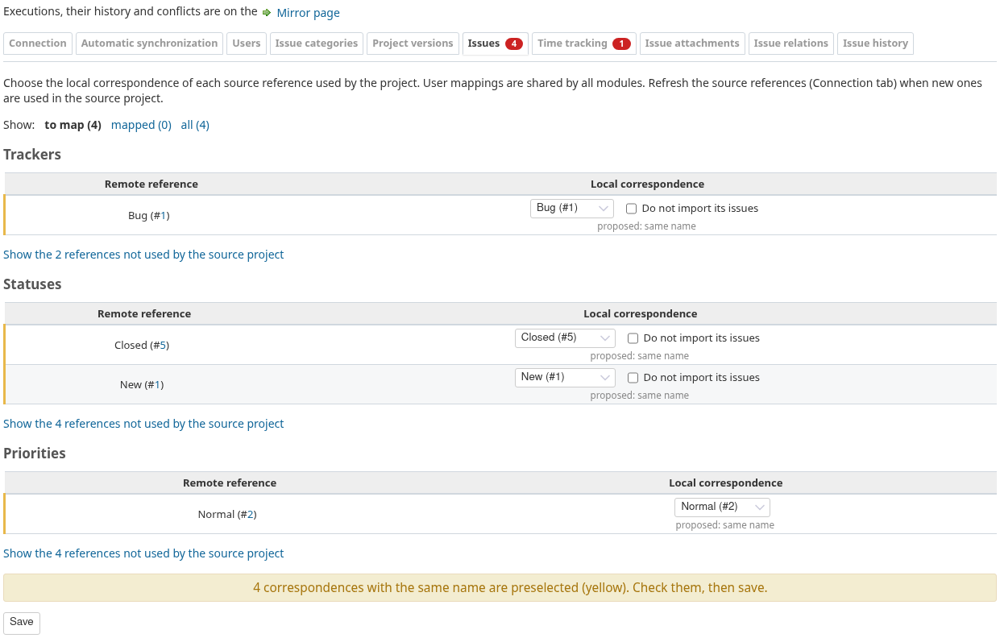

**Time tracking** maps activities.

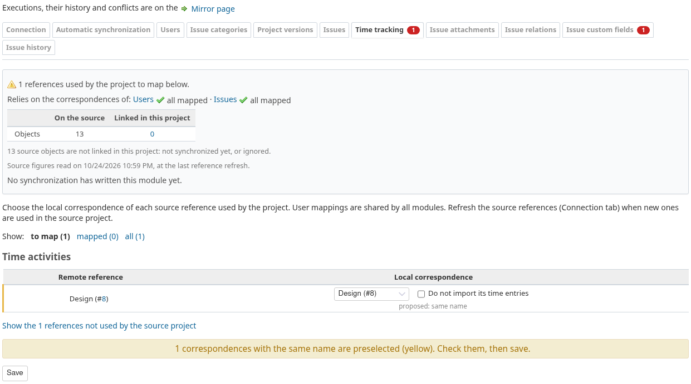

Save each tab. A reference left unmapped (an empty field, or **To configure** in short
lists) stops the objects that use it.

**Issue relations** also chooses what to do when the other end of a relation is not
imported yet: log it, or add a private note with the remote link.

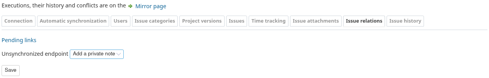

## 9. Run a preview

On the **Mirror** page, **Overview** shows the source, the modules, the schedule, the
current execution and what needs checking. Click **Run preview**.

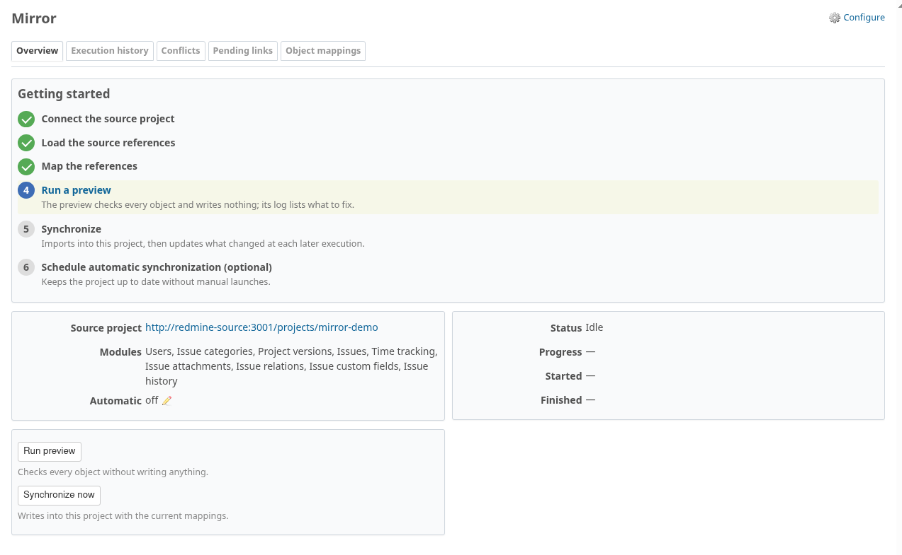

The run is queued, then processed by the worker (see [Run the worker](#run-the-worker));
the page refreshes until it finishes. The log lists what an import would do, object by
object, without writing anything.


Before the first preview, the **Mirror** page lists what the configuration alone
reveals: references without correspondence, disabled project modules, mapped fields the
project does not use. A local reference that exists in Redmine under the same name but is
not offered (a tracker not enabled in the project, a status no workflow uses, an inactive
activity, a user who is not a member) is pointed out with the page that enables it.

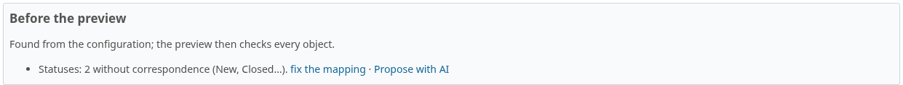

In the log, errors are grouped by cause, the largest first: fixing one unblocks all its
objects. Each cause is explained, with links to where it is fixed when the current user
may do it (a mapping tab, the project settings, a custom field, a workflow, a conflict),
otherwise who to ask. A version inherited from a parent project points to the local
project that mirrors that parent: synchronize it first.

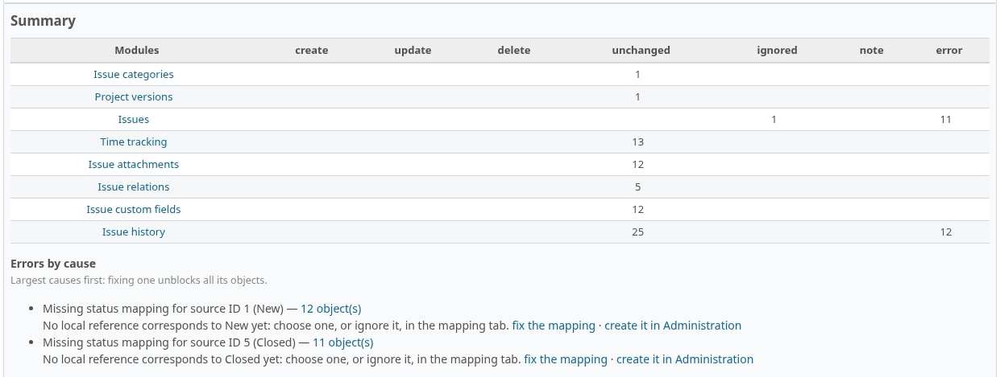

Errors do not block the rest: with **Skip it and synchronize the rest** (the default), a
preview with errors ends **Partial**, and a synchronization writes every other object.
The failing ones are retried by the next synchronization. With **Stop: write nothing**,
the preview ends **Failed** and nothing is written until every error is fixed.

## 10. Synchronize

Click **Synchronize now**. The log gives, for each object, its remote and local IDs with
links, and the action taken. Its **Summary** counts the actions per module, groups the
errors and warnings by cause, and lists the **special cases to check**: converted texts,
issue numbers, links to the source Redmine, images and links to attachments. Click one
to list the objects concerned, each with its local and source links. The preview shows
them too, before anything is written.

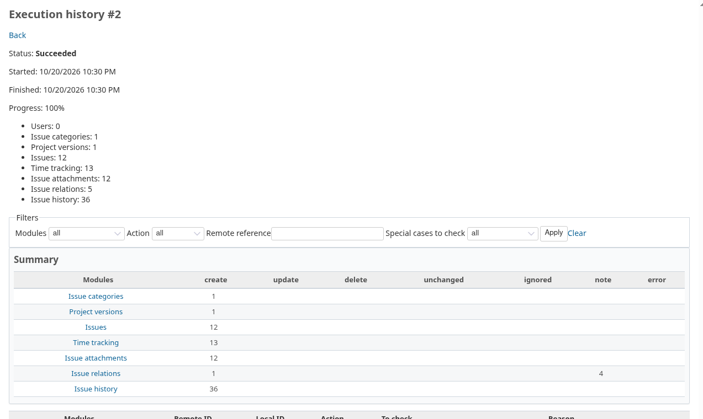

Once a synchronization has succeeded, **Overview** no longer shows Getting started.

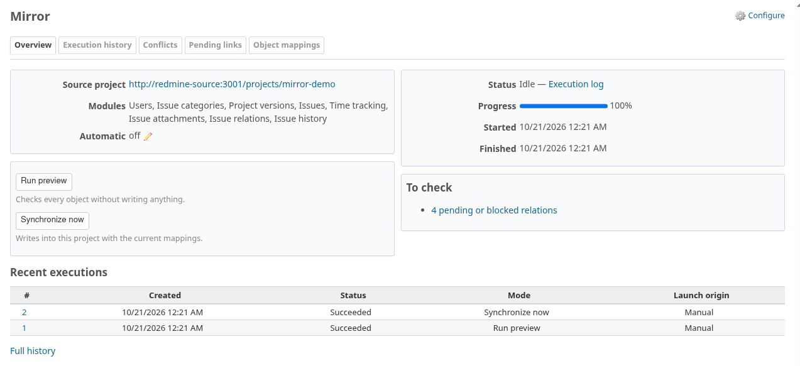

**Object mappings** lists every remote/local correspondence.

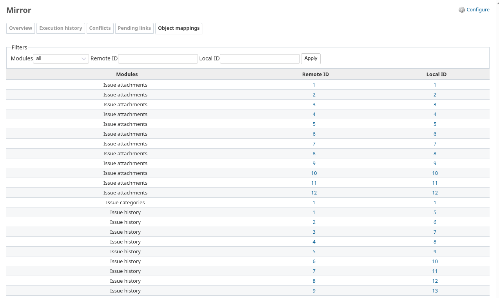

Each module tab starts with an overview: what is left to map, in the tab or in the
modules it relies on, the source objects against those linked in the project, and the
last synchronization. Source figures are read with the references.

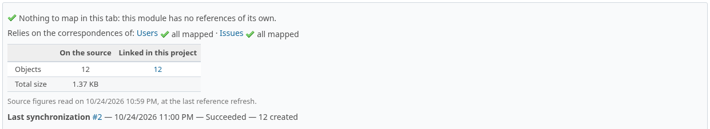

Imported issues keep their author, dates, notes and attachments. Members who can view
Mirror see a **Mirror source issue** link.

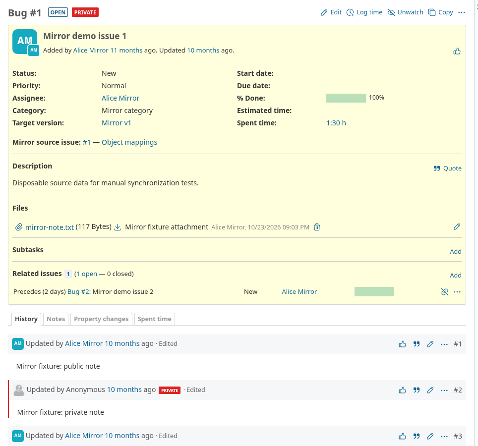

Relations and parents in projects not mirrored yet wait in **Pending links**. Import
those projects, then synchronize this one again.

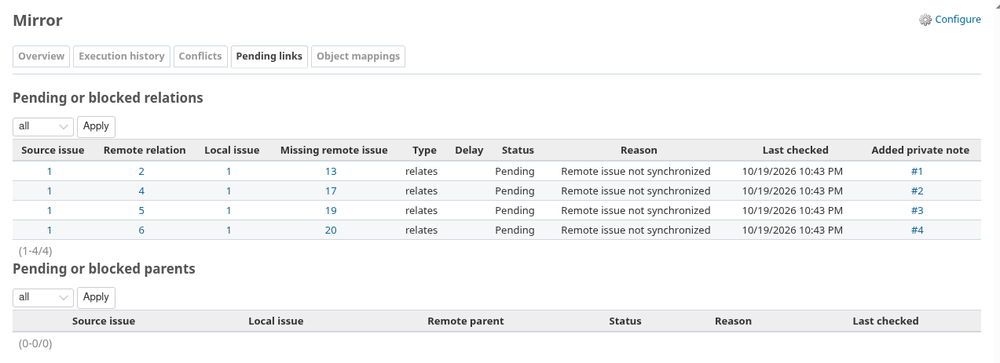

## 11. Schedule automatic runs

In **Settings → Mirror → Automatic synchronization**, tick **Enable automatic
synchronization**, choose a frequency (5 minutes to 1 day) and what to do when an object
fails, then save. The next execution date is displayed.

Tick **The source wins (mirror mode)** for an exact copy: local changes are overwritten,
local deletions recreated and source deletions propagated (see the
[module reference](MODULES.md#mirror-mode)). Leave it unticked when the project is also
worked on locally: local changes are then reported as conflicts.

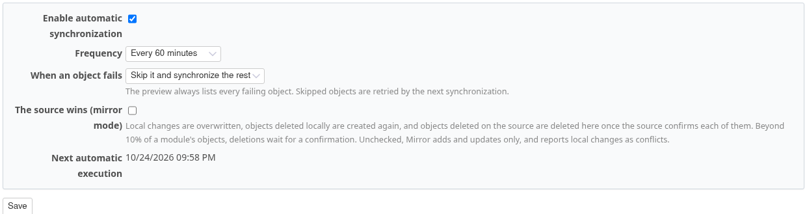

**Execution history** lists every run, with filters by status, mode, origin, module and
date.

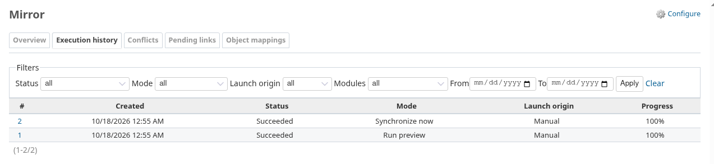

## 12. Handle conflicts

Mirror never overwrites a local change. Here, a destination user edited an imported
issue's subject: the next run leaves it unchanged and reports it.

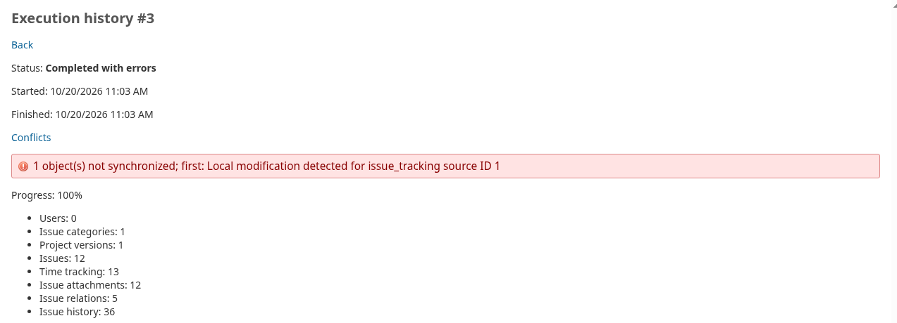

**Conflicts** lists the object and the reason; its tab shows the number of open ones.

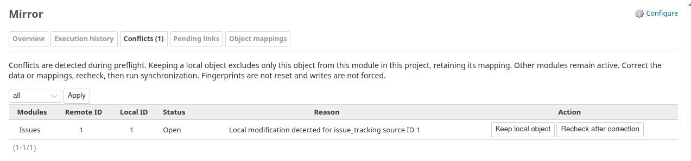

- **Keep local object**: excludes this object from this module, then synchronize again.
- **Recheck after correction**: after restoring the data or fixing a mapping.

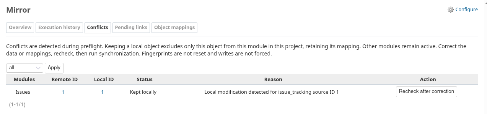

## 13. Follow usage and load

`Administration → Mirror` has two pages in its sidebar: **Destination: mirrored
projects** (below) and **Source: shared resources**
([Mirror source](#mirror-source-on-the-source-redmine)). The first lists the projects
Mirror is configured in, as a Redmine query:
filters (module, mirror mode, activity, last status, last run date, conflicts…), columns,
grouping (root or parent project, source Redmine, status…), sorting, totals and CSV
export. Columns cover the configuration (modules, mirror mode, schedule), the activity
(running or queued, last run, last success, duration, message) and the load (runs,
recent runs, total and average duration, objects processed, mappings, conflicts).

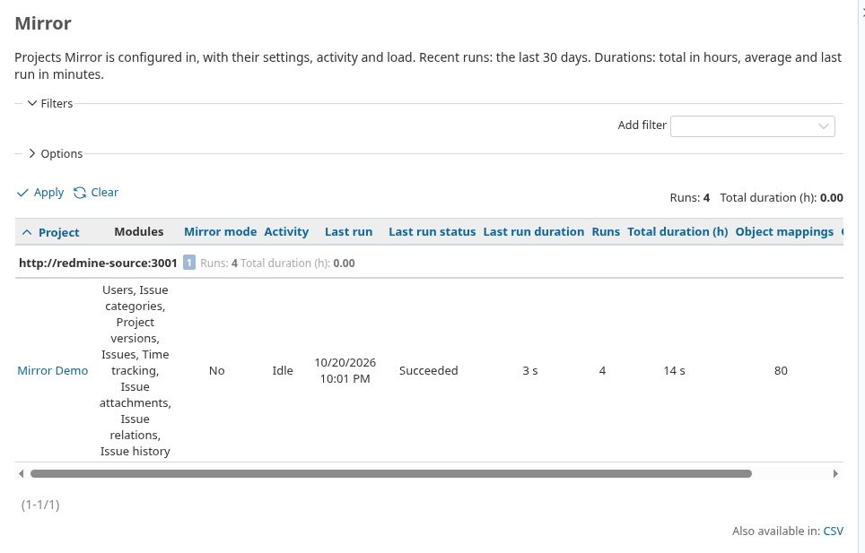

## AI proposals (optional)

For long mapping lists, an administrator can enable AI proposals in
**Administration → Mirror → AI**: provider, key, model and daily limit. **Test the
connection and list the models** checks the key without spending credit. See
[AI usage](AI.md) for the rules and the data sent.

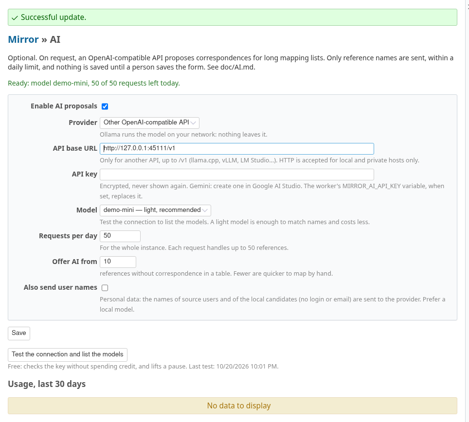

A mapping table with enough references without correspondence then offers
**Propose with AI**, with the number of requests it needs.

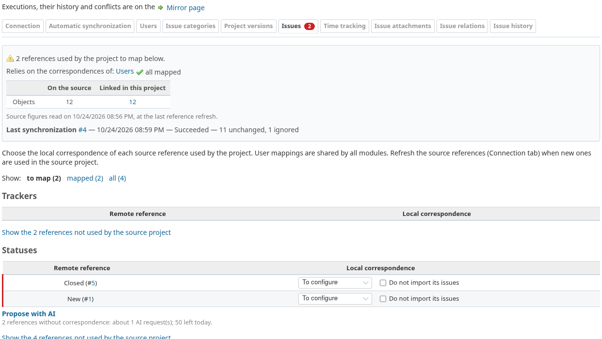

The worker asks the AI; the proposals are preselected in yellow, marked *proposed by
AI* with a confidence. Check them, then save.

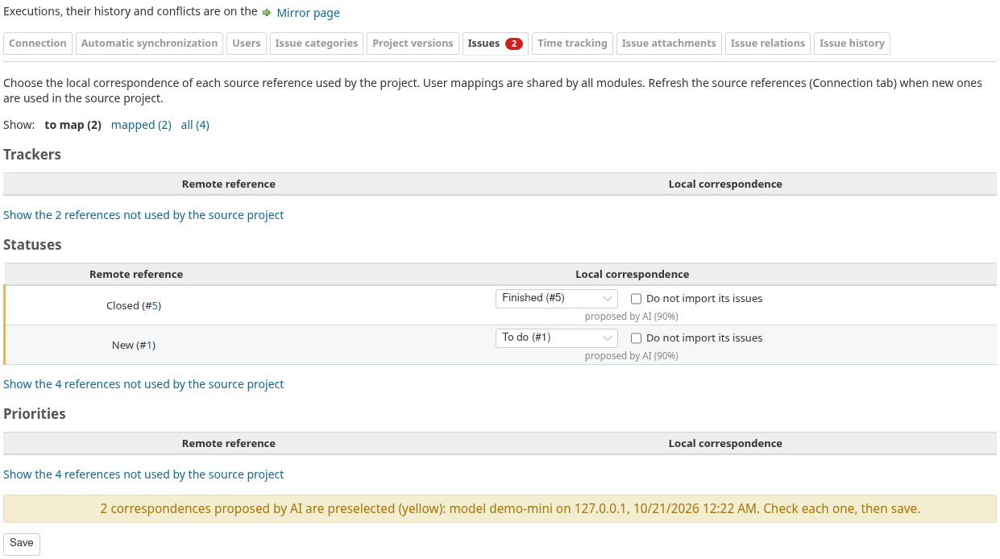

## Default correspondences (optional)

When many projects come from the same source, an administrator sets their common
correspondences once in **Administration → Mirror → Default correspondences**: source
names and their local reference, a fallback per table, custom field list values, with a
CSV import and export. Each project saves them when it reads its source references. See
[Default correspondences](DEFAULT_MAPPINGS.md).

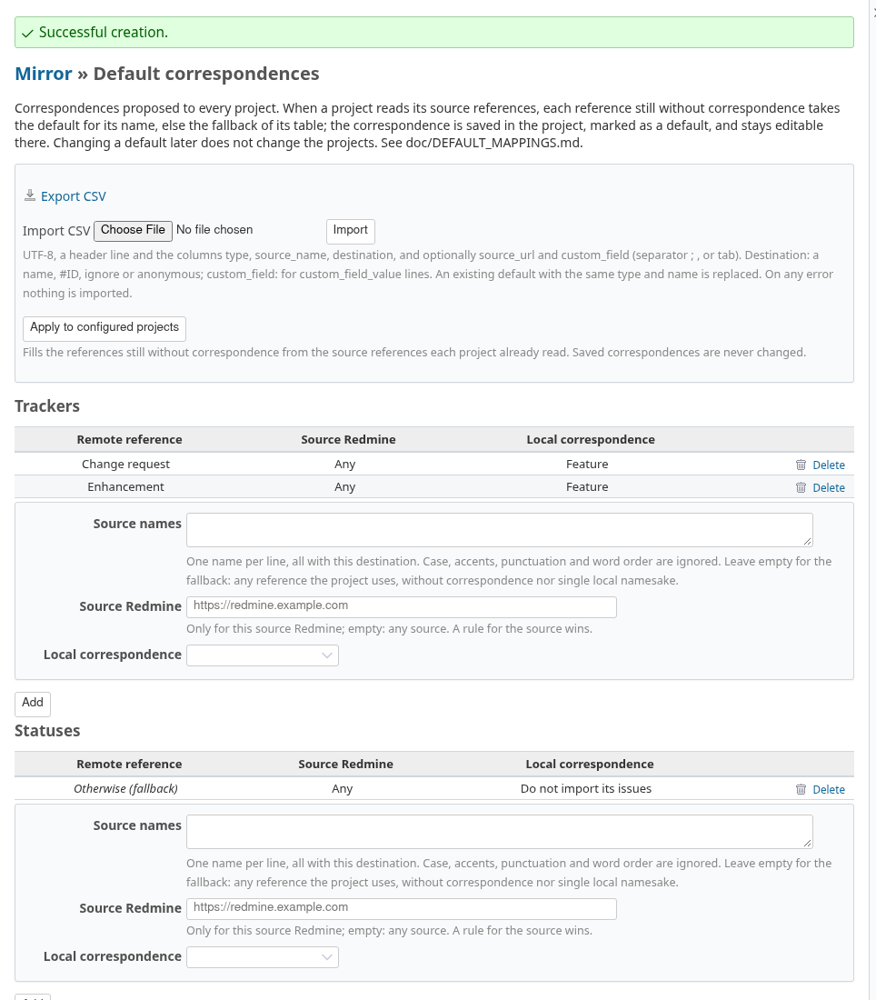

## Mirror source (on the source Redmine)

Only for the **Documents**, **News**, **Tags**, **Agile** and **Saved queries** modules,
and to create accounts from the source users: Redmine's REST API provides no documents,
no news comments nor files, no tags, no Scrum sprints, only the names of saved queries,
and users' logins and emails to administrators only. On the source Redmine:

1. Install Redmine Mirror (1.0.0-beta.19 or later for Documents, 1.0.0-beta.26 for News,
   1.0.0-beta.28 for Tags, 1.0.0-beta.30 for Scrum sprints, 1.0.0-beta.31 for Saved
   queries, 1.0.0-beta.32 for Users) and run its migration (see the README).
   Nothing else of Mirror needs configuring there. On Redmine 4.0 to 4.2, Mirror runs as
   a source only: Mirror source and its administration page, no Mirror project module.
2. `Administration → Plugins → Redmine Mirror → Configure`: check **Allow Mirror
   source**, and under **Data projects may share** the data allowed. Off, nothing is
   shared, whatever the projects check. Only the data this Redmine can provide is listed
   (Tags need the Redmine Tags plugin, Scrum sprints the Scrum plugin); projects do not
   see the rest, which is refused to destinations.

   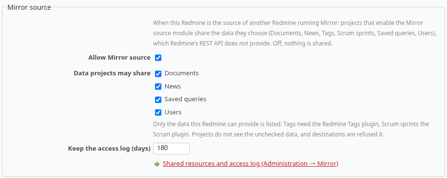
3. In the project: `Settings → Modules`, enable **Mirror source** (the **Mirror** module
   is not needed), then in `Settings → Mirror source` check **Documents**, **News**, **Tags**,
   **Scrum sprints**, **Saved queries** and/or **Users** and save. Sharing Saved queries shows the
   destination every query of the project, private ones included. Sharing Users gives
   the login, name, email and company (the user field chosen in the plugin settings, or
   named Company) of the users the destination asks for, only if they are members of the
   project or appear in its data (issues, notes, time entries, watchers, news, wiki, files).

   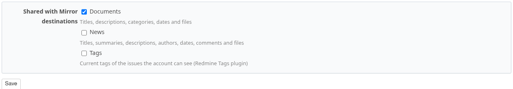
4. Give the source API account *View documents* (Documents), *View news* (News) or
   *View issues* (Tags, Saved queries, Users) or *View sprint board* (Scrum sprints) in that project. Anonymous access is refused, even on public projects.

The **Access log** below the sharing lists one session per destination run or reference
refresh: account, address, purpose, objects listed, files sent and refusals. **Details**
lists each request and what it sent. Refused requests name the lock that refused them.

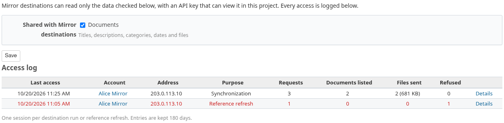

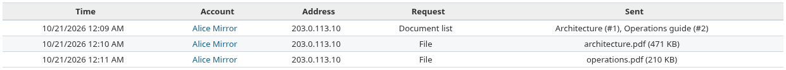

Entries are kept 180 days by default (plugin settings). Configuring the sharing and
reading the log need the permission *Configure Mirror source and read its access log*.
`Administration → Mirror → Source: shared resources` shows whether Mirror source is
allowed, the projects that enabled the module with what they share, their last access
and sessions, then the sessions of every project, filtered by project or to those with
refusals, each with its details:

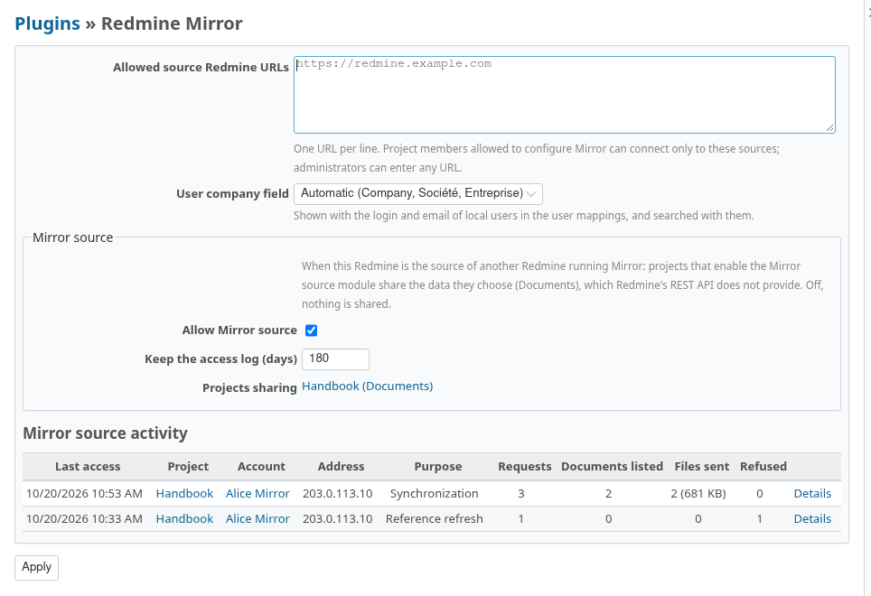

## Run the worker

Runs are processed by the worker, a command scheduled every minute on the destination
server (cron, systemd timer). It needs the same database, plugins, attachment storage and
`database_cipher_key` as Redmine:

```sh
MIRROR_DESTINATION_URL=https://redmine.example MIRROR_DESTINATION_API_KEY=... \
  RAILS_ENV=production bundle exec rake redmine_mirror:tick
```

`MIRROR_DESTINATION_API_KEY` belongs to a destination account allowed to create issues,
log time for the mapped users and perform the workflow transitions. Without the worker,
runs stay **Queued** and block new ones: after 5 minutes the **Overview** warns about it,
and **Cancel this execution** withdraws a queued run.

## Troubleshooting

| Symptom | Check |
| --- | --- |
| No **Mirror** menu | Step 5, then *View Mirror* (step 4). |
| No **Mirror** tab in the project settings | *Configure Mirror* (step 4). |
| "This source Redmine URL is not allowed" | An administrator adds it to the allowed sources (step 3). |
| "A trusted HTTPS Redmine URL is required" | Use an `https://` URL without credentials, query or fragment. |
| "Configure database_cipher_key…" | Set `database_cipher_key` in `config/configuration.yml`, then restart. |
| A reference is missing in a table | **Refresh source references**; check what the source API key can see. |
| A local user is missing from the choices | Add them to the project, or select **Members** and map them as a user with *Manage members*. |
| Run stays **Queued**, "already queued or running" | The worker is not running: schedule `redmine_mirror:tick`, or cancel the run in **Overview**. |
| "HTTP 403 for GET …" | The source account lacks the permission for that request (step 2). |
| "The source Redmine does not list documents" (or news) | Install Redmine Mirror 1.0.0-beta.19 or later (1.0.0-beta.26 for news) on the source and restart it. |
| "Mirror source is disabled…", "Enable the Mirror source module…", "Share Documents…", "Share News…" | Open that lock on the source: [Mirror source](#mirror-source-on-the-source-redmine). |
| "The source project does not list its files" | Enable the Files module on the source project and give the source account *View files*. |
| "MIRROR_DESTINATION_URL is not configured" | Set both variables in the worker's environment. |
| Preview ends Partial or Failed on a mapping | Complete the module tabs with a red counter (steps 7 and 8); with *Skip it*, the rest is synchronized meanwhile. |
| Run reports a conflict | Step 12. |
| Relations or parents pending | Import the other project, then rerun this one. |

## Regenerating the screenshots

```sh
bash test/documentation/run.sh
```

It runs the test in a disposable container (Redmine 6.1.4, SQLite, Chromium), with a
seeded source Redmine on the side, then the [exact copy guide](MIRROR_COPY.md). It
updates `doc/screenshots/configuration/`, `doc/screenshots/mirror-copy/` and the README
image. These tests are not part of `redmine:plugins:test`. The
[Redmine 4 to 5 migration guide](MIGRATION_4_TO_5.md) has its own runner,
`test/documentation/migration_run.sh`, with a real Redmine 4.2 source.
