<!--
File: redmine_mirror/doc/CONFIGURATION.md

Redmine Mirror - modular project import and asynchronous replication.
SPDX-License-Identifier: GPL-2.0-or-later

This program is free software: you can redistribute it and/or modify it
under the terms of the GNU General Public License as published by the
Free Software Foundation, either version 2 of the License, or (at your
option) any later version.

This program is distributed in the hope that it will be useful,
but WITHOUT ANY WARRANTY; without even the implied warranty of
MERCHANTABILITY or FITNESS FOR A PARTICULAR PURPOSE. See LICENSE for details.

Document Mirror setup, operation, extension points or validation evidence.
-->

# Configuration guide

From an installed plugin to a first synchronization, in eleven steps. Everything
happens on the **destination** Redmine; the source only needs its REST API and an API
key. Module details are in the [module reference](MODULES.md).

The screenshots come from the browser test
[`configuration_test.rb`](../test/documentation/configuration_test.rb). It mirrors the
*mirror-demo* project of a seeded source (12 issues with notes, attachments, a category,
a version and relations to other projects) into an empty *Mirror Demo* project. That
disposable setup uses HTTP; real installations require HTTPS.

## 1. Check the installation

`Administration → Plugins` lists **Redmine Mirror**. If not, see
[Installation](../README.md#installation).


## 2. Enable the REST API

`Administration → Settings → API`: tick **Enable REST web service**, on both the source
and the destination. The worker writes issues and time entries through the destination
API.


The source API key determines what can be imported: data it cannot see is skipped.
Use the key of a dedicated, non-administrator source account, member of the source
projects with a read-only role:

| Source permission | Needed for |
| --- | --- |
| View issues, issues visibility **All issues** | Issues, private issues, history, relations, hierarchy, versions |
| View private notes | Private notes |
| View spent time, visibility **All time entries** | Time tracking |
| View watchers list | Watchers |
| Manage issue categories (optional) | Category default assignees; without it, categories come from the issues that use them |

Two exceptions need an administrator key: the **Issue custom fields** module (Redmine
gives custom field definitions to administrators only) and projects the account is
not a member of.

## 3. Grant the permissions

`Administration → Roles and permissions → <role>`, **Mirror** block:

- **View Mirror**: open the Mirror tab;
- **Configure Mirror mappings**: edit mappings, run and schedule synchronizations,
  read logs and handle conflicts.

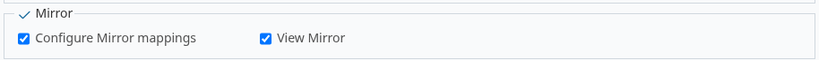

The connection itself (step 5) is reserved to administrators.

## 4. Enable the module

`Project → Settings → Project`: tick **Mirror** under **Modules**, then save. Keep
*Issue tracking* and *Time tracking* enabled for the modules you import.

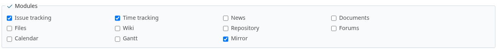

The **Mirror** tab appears in the project menu.


## 5. Connect the source

Open **Mirror**. In **Synchronization configuration → Connection**, an administrator
enters:

- **Source Redmine URL**;
- **Source project**: its identifier, as in `<source>/projects/<identifier>`, or its numeric ID;
- **Source API key**: stored encrypted and never displayed again;
- **Modules** to import. Dependencies are added on save: *Time tracking* adds *Issues*,
  and both add *Users*.

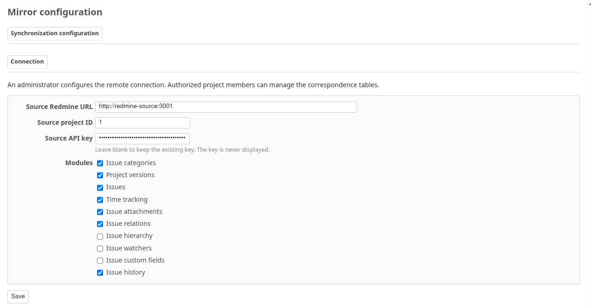

Saving checks the connection and loads the source references. The URL and project ID
cannot be changed afterwards. **Refresh source references** reloads them after new
users, statuses or activities appear on the source.

## 6. Map users

**Modules and mappings → Users** lists the users found in the source data. Map each one
to an active member of the project, or **Anonymize** them. Time logged by an anonymized
user goes to the **local user for anonymized time**: here the source administrator is
anonymized and a dedicated *Mirror Archive* member receives that time.

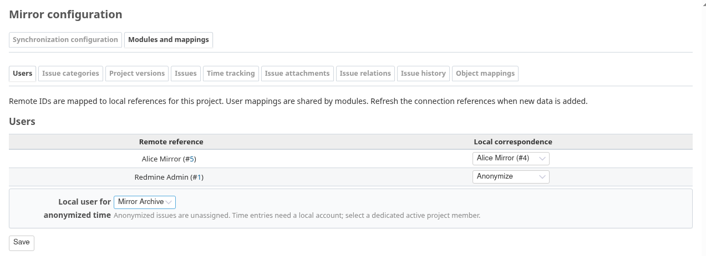

Mirror never creates accounts: add the missing members to the project first. The user
table is shared by every module.

## 7. Map the references

Each module tab lists the source references it needs. **Issues** maps trackers,
statuses and priorities. Only the references used by the source project's issues and
their history are listed, plus those already mapped; a link shows the others. Local
statuses are limited to those of the project's tracker workflows. Long lists, such as
users, can be filtered by typing.

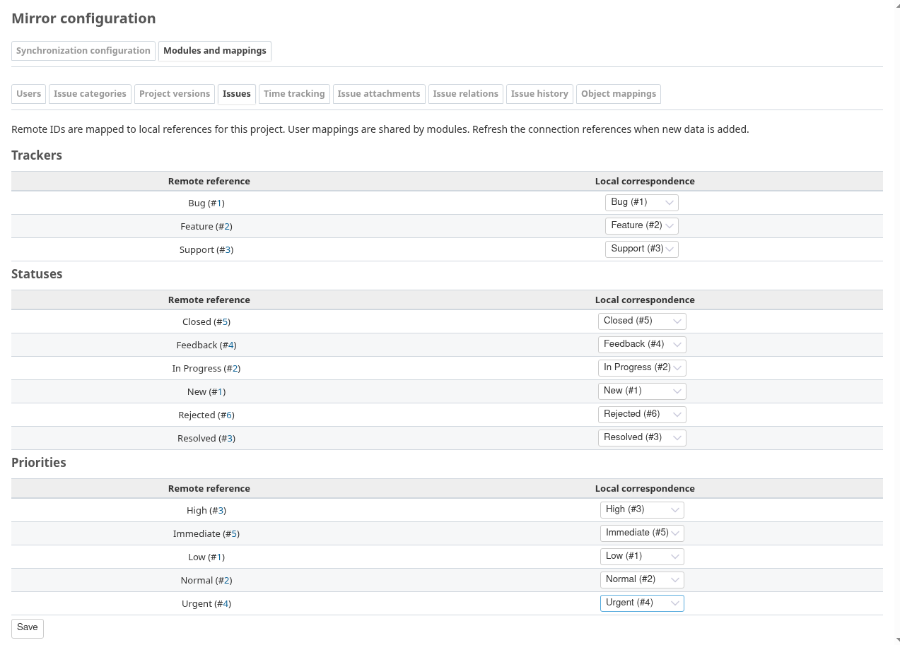

**Time tracking** maps activities.

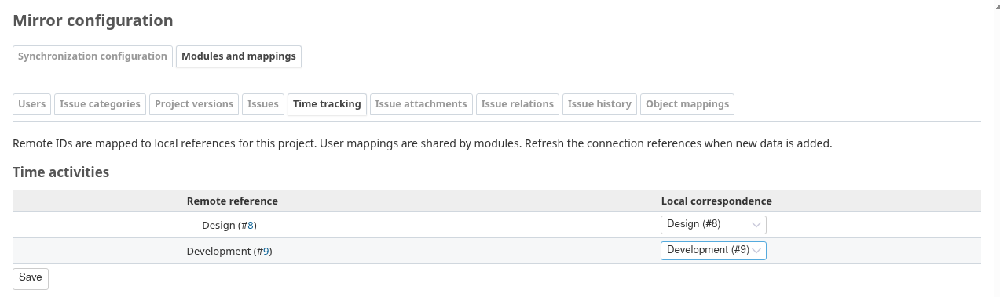

Save each tab. A reference left on **To configure** blocks the preview.

**Issue relations** also chooses what to do when the other end of a relation is not
imported yet: log it, or add a private note with the remote link.

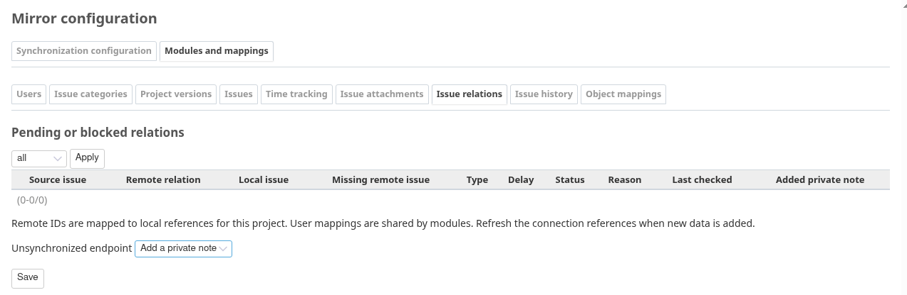

## 8. Run a preview

In **Synchronization configuration → Synchronization**, click **Run preview**.

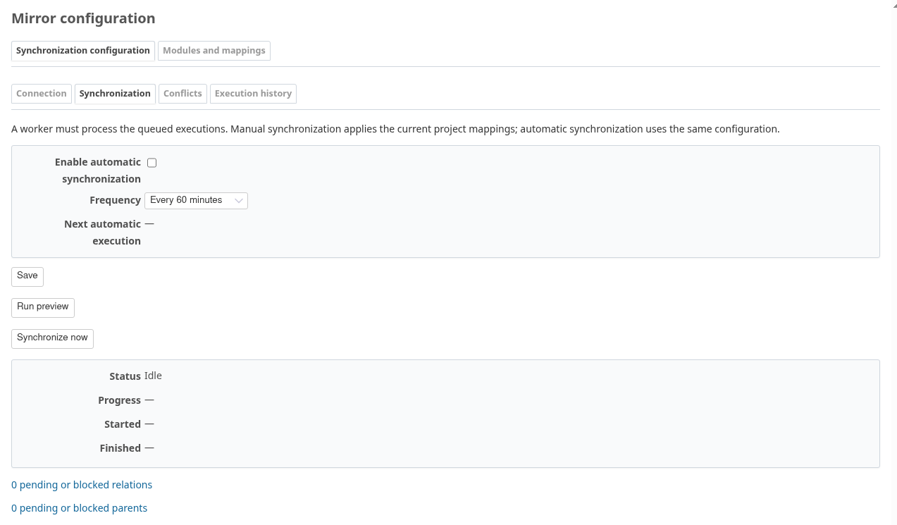

The run is queued, then processed by the worker (see [Run the worker](#run-the-worker)).
Refresh the page: the log lists what an import would do, object by object, without
writing anything.

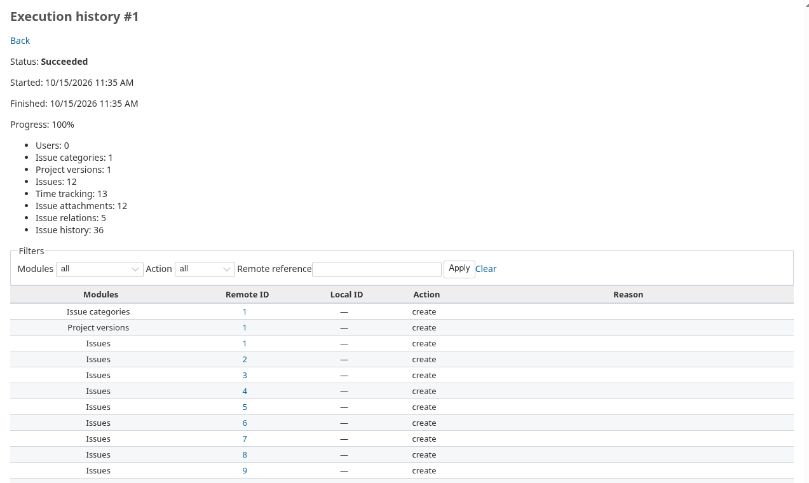

A missing mapping or a local change stops the preview with an explicit error.

## 9. Synchronize

Click **Synchronize now**. The log gives, for each object, its remote and local IDs with
links, and the action taken.


The **Synchronization** tab shows the last run, its progress and the pending relations
and parents.

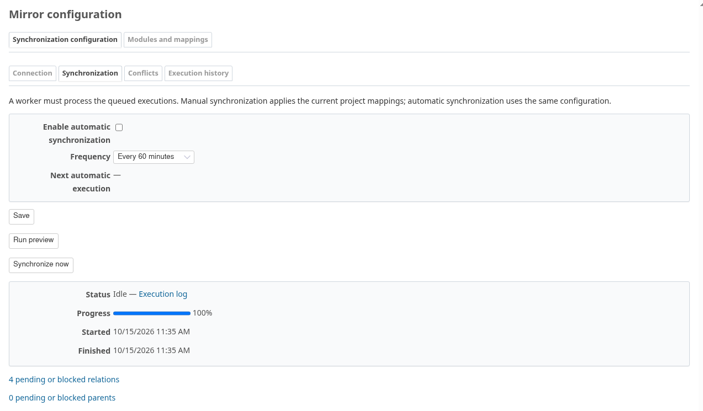

**Modules and mappings → Object mappings** lists every remote/local correspondence.

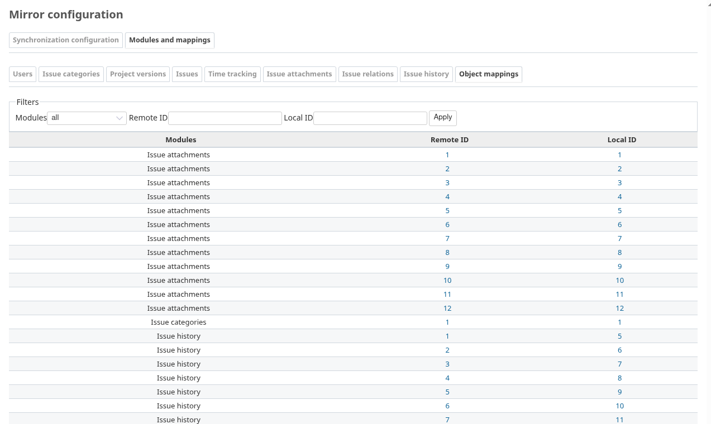

Imported issues keep their author, dates, notes and attachments. Members who can
configure Mirror see a **Mirror source issue** link.


Relations to projects not mirrored yet stay pending, in the **Issue relations** tab.
Import those projects, then synchronize this one again.

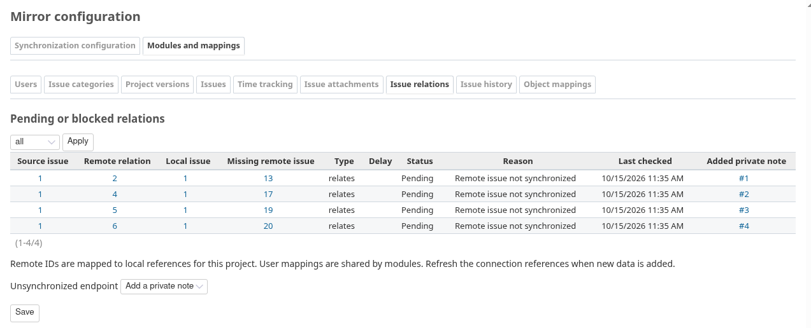

## 10. Schedule automatic runs

In **Synchronization**, tick **Enable automatic synchronization**, choose a frequency
(5 minutes to 1 day) and save. The next execution date is displayed.

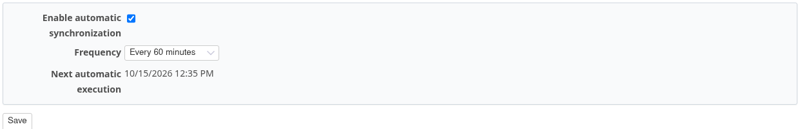

**Execution history** lists every run, with filters by status, mode, origin, module and
date.

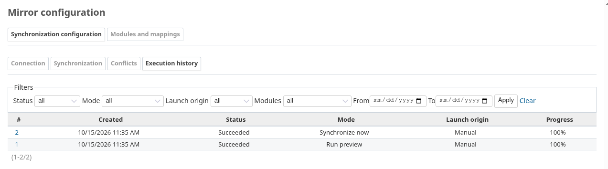

## 11. Handle conflicts

Mirror never overwrites a local change. Here, a destination user edited an imported
issue's subject: the next run stops before writing.

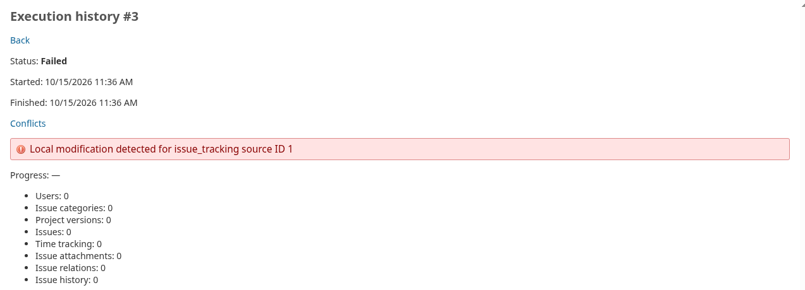

**Conflicts** lists the object and the reason.

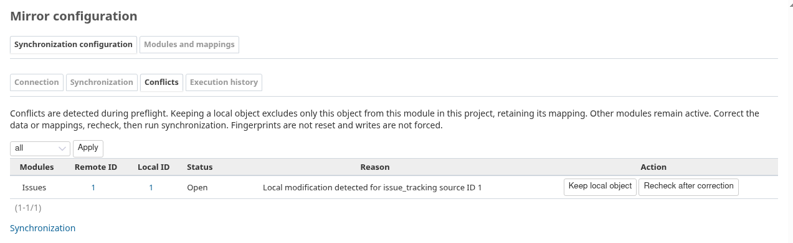

- **Keep local object**: excludes this object from this module, then synchronize again.
- **Recheck after correction**: after restoring the data or fixing a mapping.

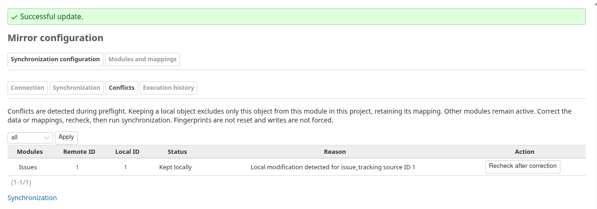

## Run the worker

Runs are processed by the worker, a command scheduled every minute on the destination
server (cron, systemd timer). It needs the same database, plugins, attachment storage and
`database_cipher_key` as Redmine:

```sh
MIRROR_DESTINATION_URL=https://redmine.example MIRROR_DESTINATION_API_KEY=... \
  RAILS_ENV=production bundle exec rake redmine_mirror:tick
```

`MIRROR_DESTINATION_API_KEY` belongs to a destination account allowed to create issues,
log time for the mapped users and perform the workflow transitions. Without the worker,
runs stay **Queued**.

## Troubleshooting

| Symptom | Check |
| --- | --- |
| No **Mirror** tab | Step 4, then *View Mirror* (step 3). |
| Connection fields read-only | Only administrators edit the connection. |
| "A trusted HTTPS Redmine URL is required" | Use an `https://` URL without credentials, query or fragment. |
| "Configure database_cipher_key…" | Set `database_cipher_key` in `config/configuration.yml`, then restart. |
| A reference is missing in a table | **Refresh source references**; check what the source API key can see. |
| A local user is missing from the choices | Add them to the project as an active member. |
| Run stays **Queued** | The worker is not running. |
| "MIRROR_DESTINATION_URL is not configured" | Set both variables in the worker's environment. |
| Preview fails on a mapping | Complete the module tabs (steps 6 and 7). |
| Run fails on a conflict | Step 11. |
| Relations or parents pending | Import the other project, then rerun this one. |

## Regenerating the screenshots

```sh
bash test/documentation/run.sh
```

It runs the test in a disposable container (Redmine 6.1.4, SQLite, Chromium), with a
seeded source Redmine on the side. It updates `doc/screenshots/configuration/` and the
README image. The test is not part of `redmine:plugins:test`.
