<!--
File: redmine_mirror/doc/MIGRATION_4_TO_5.md

Redmine Mirror - modular project import and asynchronous replication.
SPDX-License-Identifier: GPL-2.0-or-later

This program is free software: you can redistribute it and/or modify it
under the terms of the GNU General Public License as published by the
Free Software Foundation, either version 2 of the License, or (at your
option) any later version.

This program is distributed in the hope that it will be useful,
but WITHOUT ANY WARRANTY; without even the implied warranty of
MERCHANTABILITY or FITNESS FOR A PARTICULAR PURPOSE. See LICENSE for details.

Document Mirror setup, operation, extension points or validation evidence.
-->

# Migrate a project from Redmine 4 to Redmine 5

Step by step, how to move a project from an existing **Redmine 4.2** to a new
**Redmine 5** with Mirror, then keep it up to date until the switch.

This is a **project-by-project migration to a fresh Redmine 5**, not the official
in-place upgrade (`rake db:migrate` on a copy of the Redmine 4 database). Choose it to
start from a clean instance, migrate projects one at a time, or merge several old
instances. Nothing is installed on the Redmine 4: Mirror only reads its REST API.
To migrate Documents too, install Mirror on the Redmine 4 as a source only and share
them through [Mirror source](CONFIGURATION.md#mirror-source-on-the-source-redmine).

The screenshots come from the browser test
[`migration_4_to_5_test.rb`](../test/documentation/migration_4_to_5_test.rb): a real
Redmine 4.2 source and a Redmine 5.1 destination. The demo project *mirror-demo* holds
12 issues with notes, attachments, time entries, a category and a version. That disposable
setup uses HTTP; real installations require HTTPS.

**Before you start**

- Users, groups and roles exist on the Redmine 5 (LDAP, SSO or created by hand): Mirror
  maps people to existing accounts, it never creates them.
- The Redmine 5 has the Mirror plugin, a `database_cipher_key` and a scheduled worker
  (see the [README](../README.md#installation)).
- Plan a short freeze for the switch: the source project is closed, then synchronized
  one last time.

## Part 1: prepare the Redmine 4.2 source

Done once by a Redmine 4.2 administrator.

### 1. Check the version

`Administration → Information` shows the source version.

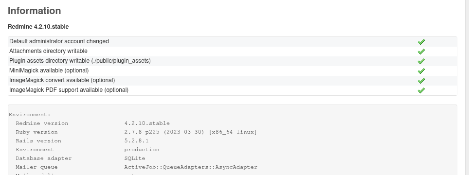

### 2. Enable the REST API

`Administration → Settings → API`: tick **Enable REST web service**, then save.

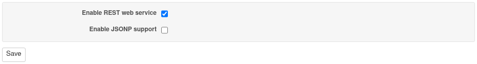

### 3. Create a read-only role

`Administration → Roles and permissions → New role`, named *Mirror reader*:

- **Issues visibility**: *All issues*; **Time logs visibility**: *All time entries*;
- untick **Issues can be assigned to users with this role**;
- tick only what Mirror reads: *View issues*, *View private notes*, *View spent time*,
  *View watchers list*, *View wiki*, *View wiki history*, *View files*, *View documents*,
  *View news*.

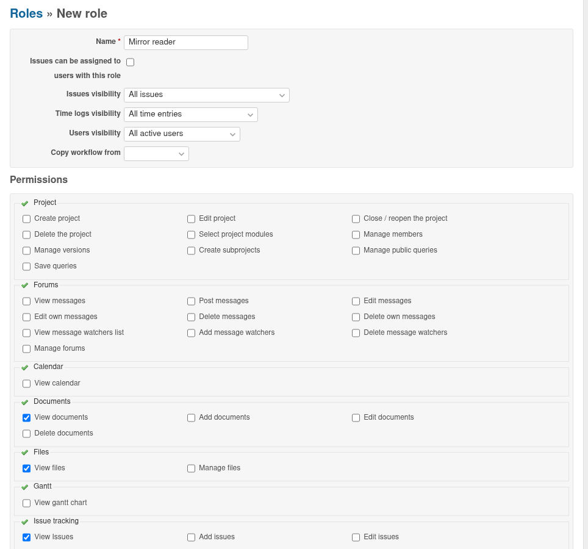

### 4. Create the service account

`Administration → Users → New user`: a dedicated account, *mirror-reader*, used only by
Mirror. Then add it to the project with the *Mirror reader* role
(**Settings → Members** of the project).

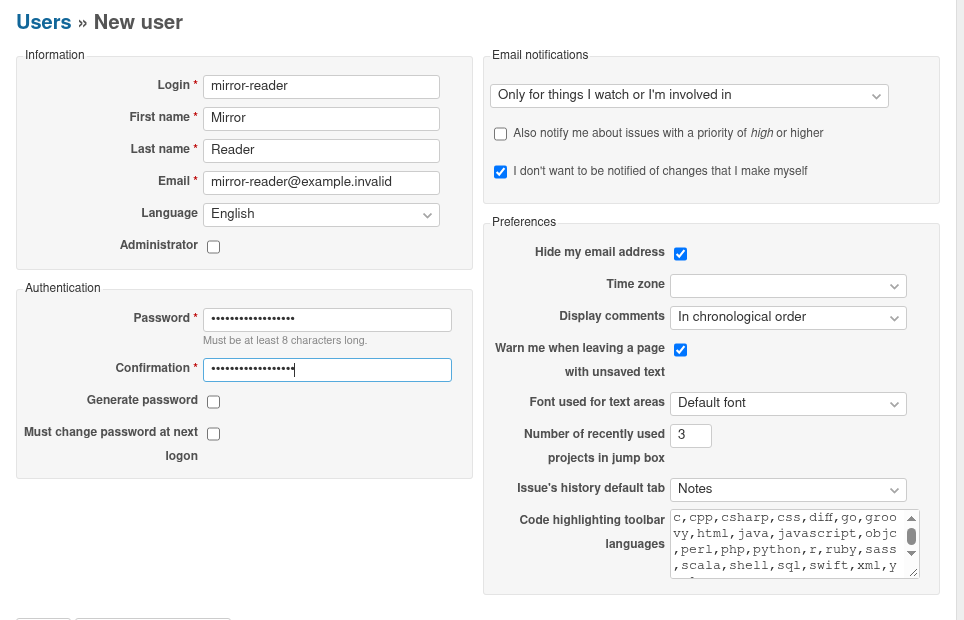

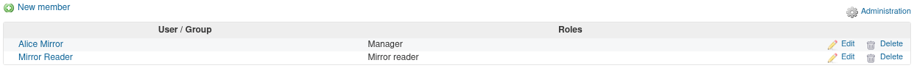

### 5. Get its API key

Log in as *mirror-reader*, open **My account** and click **Show** under *API access key*.
Copy the key: it goes into Mirror on the Redmine 5, and nowhere else.

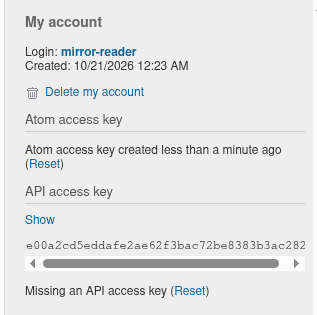

## Part 2: prepare the Redmine 5 destination

Done once by a Redmine 5 administrator.

### 6. Check the plugin

`Administration → Plugins` lists **Redmine Mirror**.

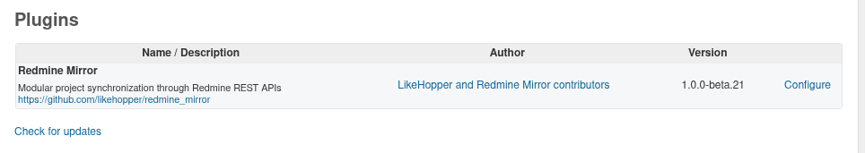

### 7. Enable the REST API and allow the source

- `Administration → Settings → API`: tick **Enable REST web service** (the worker writes
  through it).
- `Administration → Plugins → Redmine Mirror → Configure`: add the Redmine 4.2 URL to
  **Allowed source Redmine URLs**.

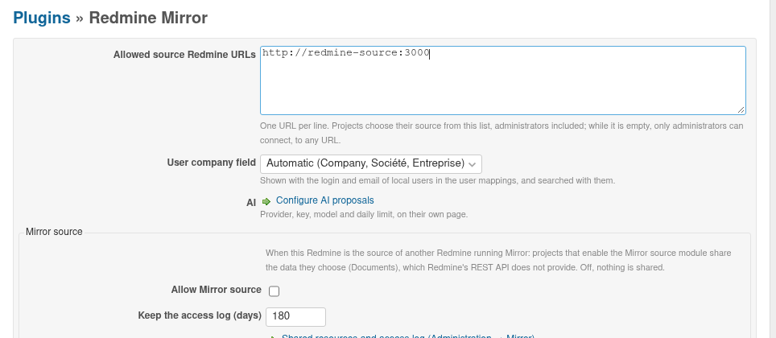

### 8. Create the destination project

`Projects → New project`, with the **Mirror** module ticked, and the modules you need
(*Issue tracking*, *Time tracking*…). Add its members.

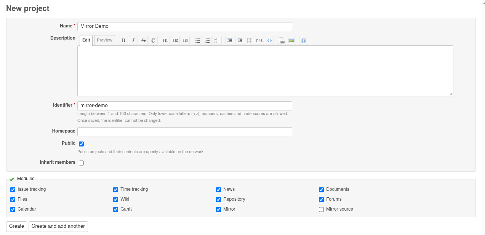

## Part 3: migrate the project

### 9. Connect

**Settings → Mirror → Connection**:

- **Source Redmine URL**: choose the Redmine 4.2;
- **Source project**: its identifier, as in `<source>/projects/<identifier>`;
- **Source API key**: the *mirror-reader* key;
- **Source text format**: *Textile*, Redmine 4.2's format; texts are converted to the
  Redmine 5 format;
- **Modules**: what to migrate.

Save: the worker reads the source references. Module tabs with a red counter still have
references to map.

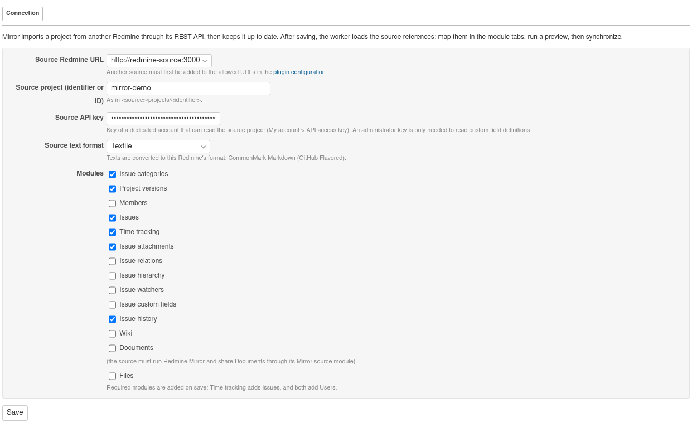

### 10. Map users and references

- **Users**: map each source user to a Redmine 5 account. *Anonymize* the ones who should
  not appear, and choose the **local user for anonymized time**.
- **Issues**, **Time tracking**: map trackers, statuses, priorities and activities.
  References with the same name are preselected: check them, then save.

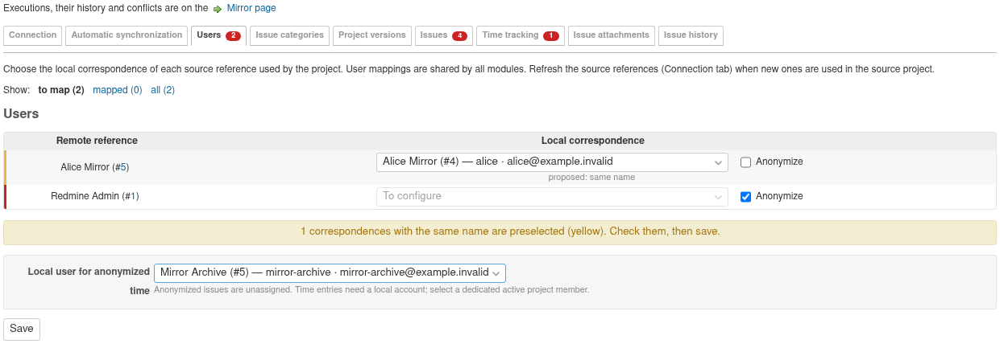

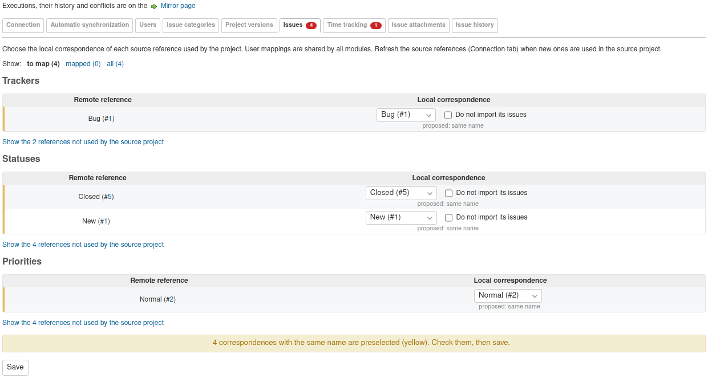

### 11. Run a preview

On the project's **Mirror** page, **Run preview**: Mirror checks every object without
writing anything. Fix what the log reports until the preview has no error: objects are
created in the source order, so issue and time entry numbers grow as on the source, but
an object skipped by one run and imported by a later one gets a higher number.

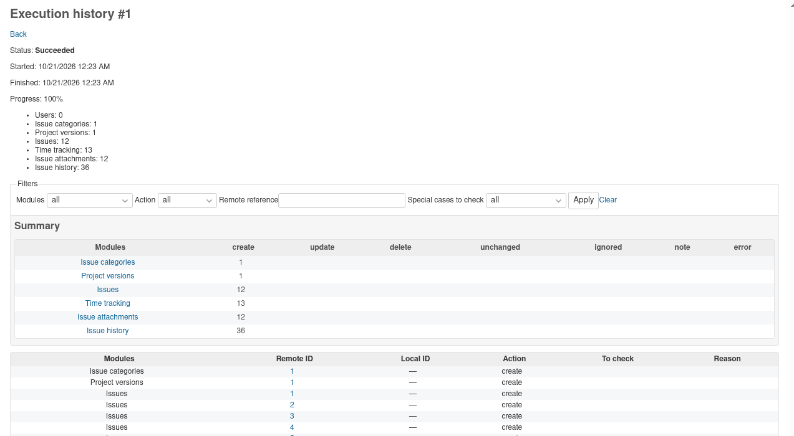

### 12. Import

**Synchronize now** imports the project: issues with their history, attachments and time
entries, with their original authors and dates.

Each imported issue shows its origin.

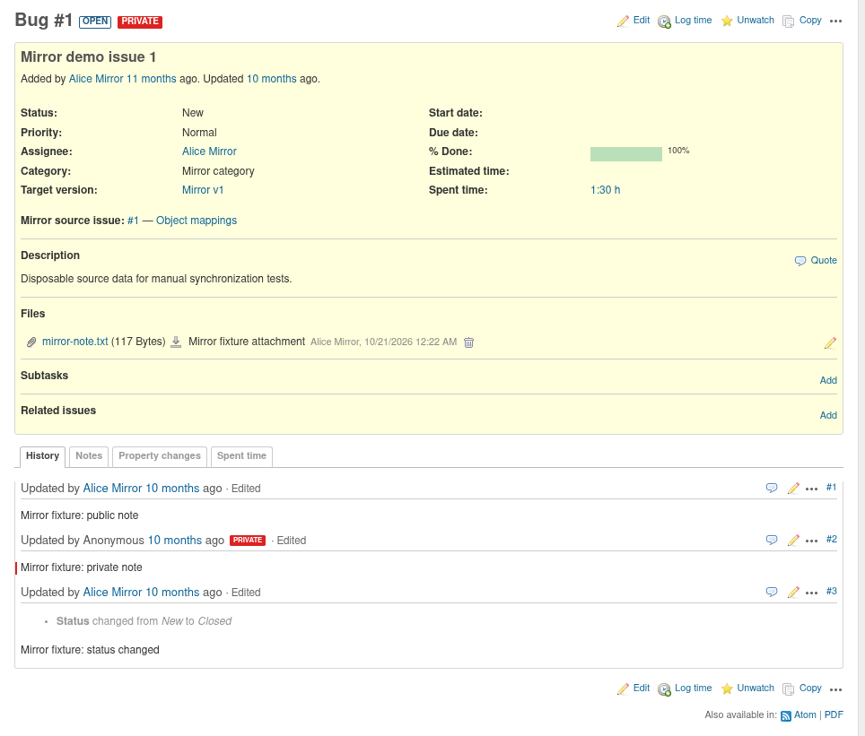

### 13. Check

`Administration → Mirror` shows the project, its last run and its counts. Compare the
issue count with the Redmine 4.2 project, and open a few issues on both sides.

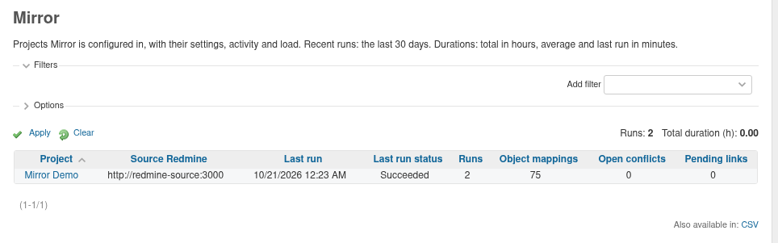

## Part 4: keep in sync until the switch

### 14. Synchronize again

Users keep working in Redmine 4.2 until the switch. Each synchronization adds what
changed: here, a note added in Redmine 4.2 after the first import.

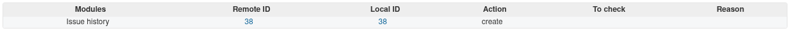

Schedule it in **Settings → Mirror → Automatic synchronization**. With **The source wins
(mirror mode)**, local changes are overwritten and source deletions propagated, so the
Redmine 5 project stays an exact copy (see [Keep an exact copy](MIRROR_COPY.md)).

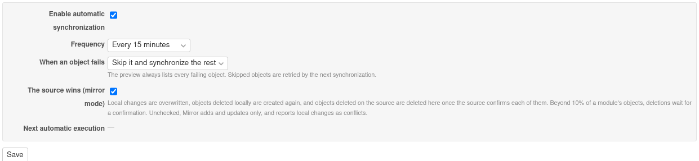

### 15. Switch

1. Close the project in Redmine 4.2 (**Close** on its overview): it stays readable, nobody
   can change it any more.
2. Run a last **Synchronize now** on the Redmine 5.
3. Turn the automatic synchronization off, then tell users the new address.

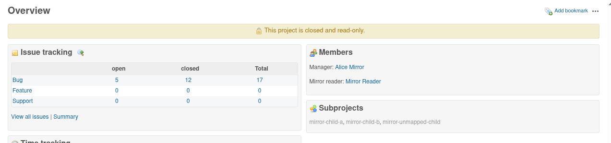

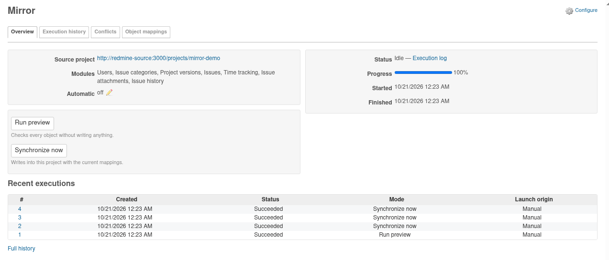

## Repeat for each project

Projects are migrated one at a time, each with its own connection and mappings. Shared
versions and cross-project relations are resolved once both projects are migrated.

## Regenerating the screenshots

`bash test/documentation/migration_run.sh` starts the official `redmine:4.2` image as the
source and a Redmine 5.1 destination with Chromium, runs the scenario and copies the
screenshots to `doc/screenshots/migration`. Another destination image can be passed as
the second argument.
