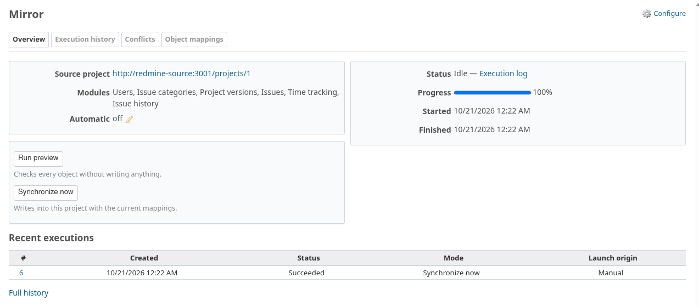
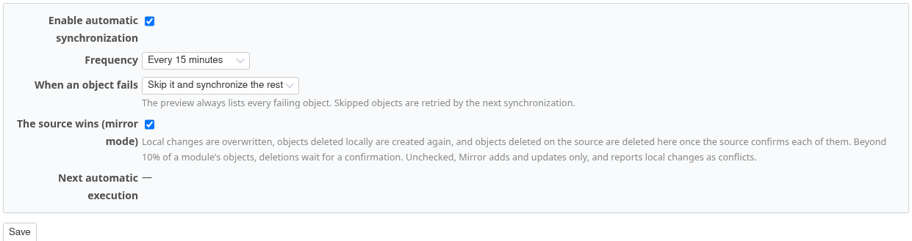
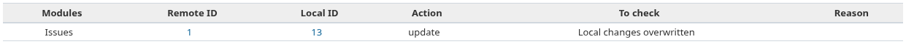
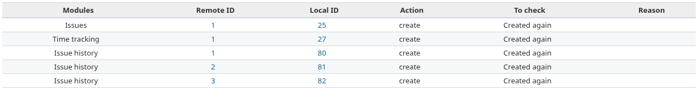
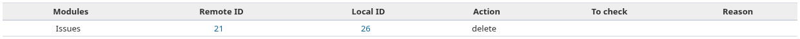
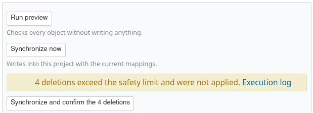
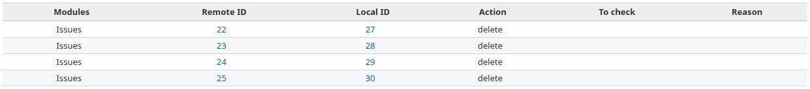
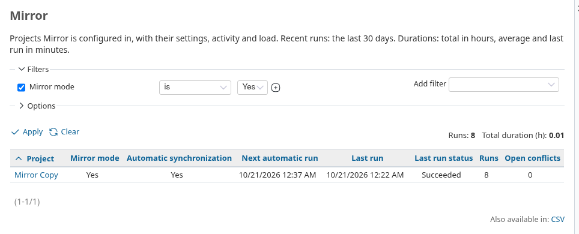

<!--
File: redmine_mirror/doc/MIRROR_COPY.md

Redmine Mirror - modular project import and asynchronous replication.
SPDX-License-Identifier: GPL-2.0-or-later

This program is free software: you can redistribute it and/or modify it
under the terms of the GNU General Public License as published by the
Free Software Foundation, either version 2 of the License, or (at your
option) any later version.

This program is distributed in the hope that it will be useful,
but WITHOUT ANY WARRANTY; without even the implied warranty of
MERCHANTABILITY or FITNESS FOR A PARTICULAR PURPOSE. See LICENSE for details.

Document Mirror setup, operation, extension points or validation evidence.
-->

# Keep an exact copy of a project

Step by step, how to make a destination project an exact, regularly updated copy of a
source project with **mirror mode**: local changes are overwritten, local deletions are
created again, and deletions made on the source are propagated, with a safety limit.

Use it for a read-only copy (reporting, archive, a customer-facing instance). If people
also work in the destination project, leave mirror mode off: local changes are then
reported as [conflicts](CONFIGURATION.md#12-handle-conflicts) instead of being overwritten.

The screenshots come from the browser test
[`mirror_copy_test.rb`](../test/documentation/mirror_copy_test.rb), which mirrors the
*mirror-demo* project of a seeded source into a *Mirror Copy* project.

## 1. Start from a configured project

Configure the connection and the mappings, and run a first synchronization, as the
[configuration guide](CONFIGURATION.md) shows. The **Mirror** page then shows the source,
the modules and the last execution.

## 2. Turn mirror mode on

In **Settings → Mirror → Automatic synchronization**:

1. tick **Enable automatic synchronization** and choose a frequency;
2. tick **The source wins (mirror mode)**;
3. save.

From now on, every run, automatic or manual, aligns the project with the source. The
worker must run (see [Run the worker](CONFIGURATION.md#run-the-worker)).

## 3. A local edit is overwritten

Someone edits an imported issue in the destination project. On the next run, Mirror
writes the source values back. In the execution log, the issue is an *update* marked
**Local changes overwritten**.

The same applies to notes, attachments, time entries, categories, versions, watchers,
member roles and wiki pages.

## 4. A local deletion is created again

An imported issue is deleted in the destination project. On the next run, Mirror creates
it again, with its history and time entries, marked **Created again**.

## 5. A source deletion is propagated

When an issue is deleted on the source, Mirror asks the source for that very issue
before deleting anything: only a *not found* answer counts. An issue that moved to
another source project, or that the API key can no longer see, is kept and logged.

Run a preview first: deletions are listed with the *delete* action, nothing is written.

Then synchronize: the local issue is deleted, with its history, time entries and
relations, as Redmine does.

## 6. Beyond the limit, confirm the deletions

A run deletes at most 10% of a module's objects (at least 2). Beyond that, it deletes
nothing: the run ends with errors, and **Overview** shows the deletions waiting.

Check the execution log, then click **Synchronize and confirm the N deletions**. The run
applies them.

## 7. Follow mirrored projects

`Administration → Mirror` lists every configured project. Filter on **Mirror mode** to
see the copies, their schedule, last run and load.

## Good to know

- Local objects Mirror did not import are never deleted.
- A version still used by local issues is not deleted; the log says so.
- Mirror mode does not create projects or accounts: users, groups and roles must exist
  on the destination.
- Details and limits: [module reference](MODULES.md#mirror-mode).

## Regenerating the screenshots

`bash test/documentation/run.sh` runs this guide after the configuration guide and
copies the screenshots to `doc/screenshots/mirror-copy`.
